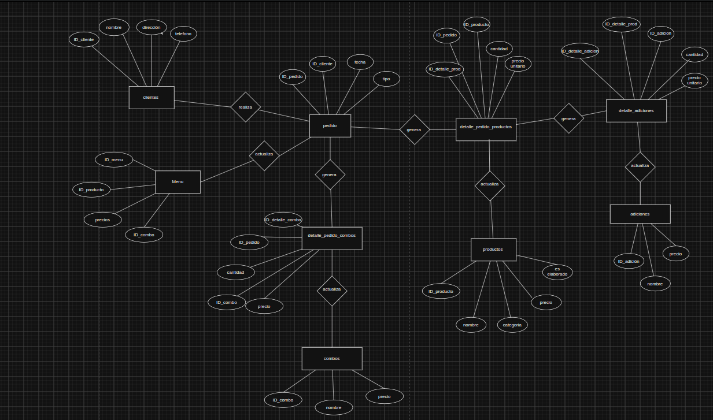
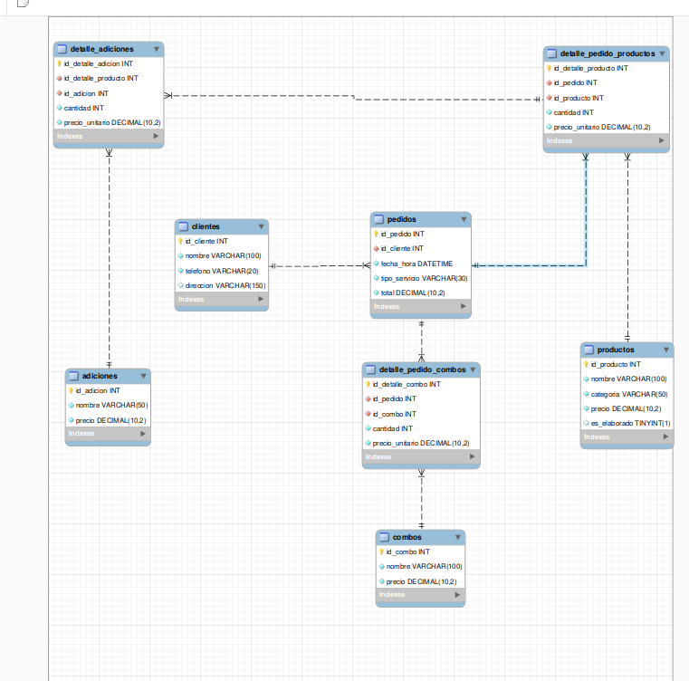

## documentación del examen SQL por Evelyn 

AQUI SE MUESTRA EL PASO A PASO QUE SE REALIZO DURANTE ESTE EXAMEN: 

## NUMERO UNO 
se realizo el diagrama entidad relacion, en draw.io  para definir las relaciones entre entidades y atributos de cada entidad 

## NUMERO DOS,

se creo en la ingenieria inversa despues de haber creado las tablas en SQL para el diagrama UML y quedaron establecidas las relaciones 

